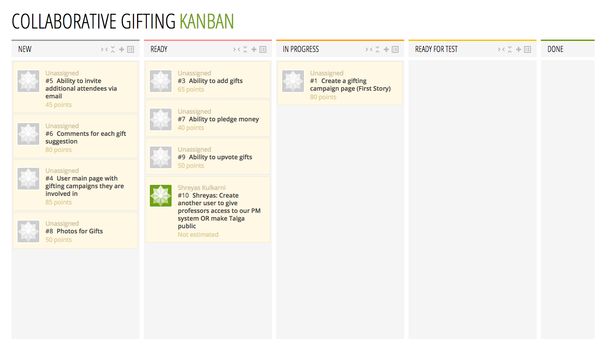

Collaborative Gifting
------------

### Background

Your friend's birthday is coming up! All of your friends are at a loss as to what to give your friend, but now with (Gift Crowdfunding), your group of friends can collaborate on the best present for your friend that falls in your group's collective budget.

### Challenge

This web app will allow users to build collaborative giftlists for each gifting occasion. Users can invite their peers to add suggestions for new gift ideas and vote up or comment on which gifts they feel would most appeal to the giftee. Users can pledge monetary amounts to add to the collective gift budget and the topmost gifts that fall in the budget category will be selected as the top purchase suggestions.

### First Story

We want a user to be able to create a campaign page with the following fields:

1. Name of giftee 
2. Description of why the campaign is created
3. The date that the campaign ends
4. Sharable public URL

### Project Management Tool

Taiga
https://tree.taiga.io/project/shreyas-collaborative-gifting/us/1

We are setting up accounts for the professors, in the meantime, here is our current project:

### Team

[Shreyas Kulkarni](/people/shreyas-kulkarni.md), [Frank Li](/people/frank-li.md), [Angel Wong](/people/angel-wong.md)

